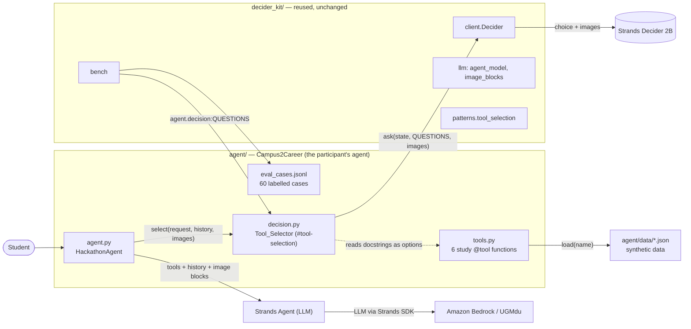
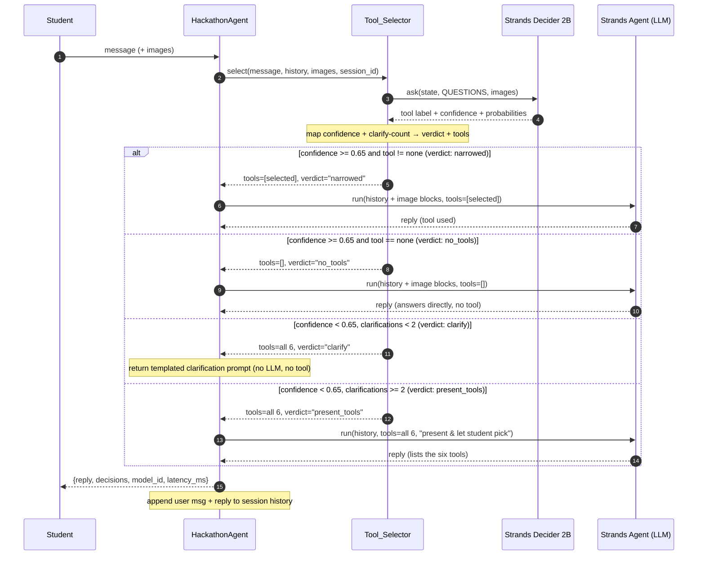
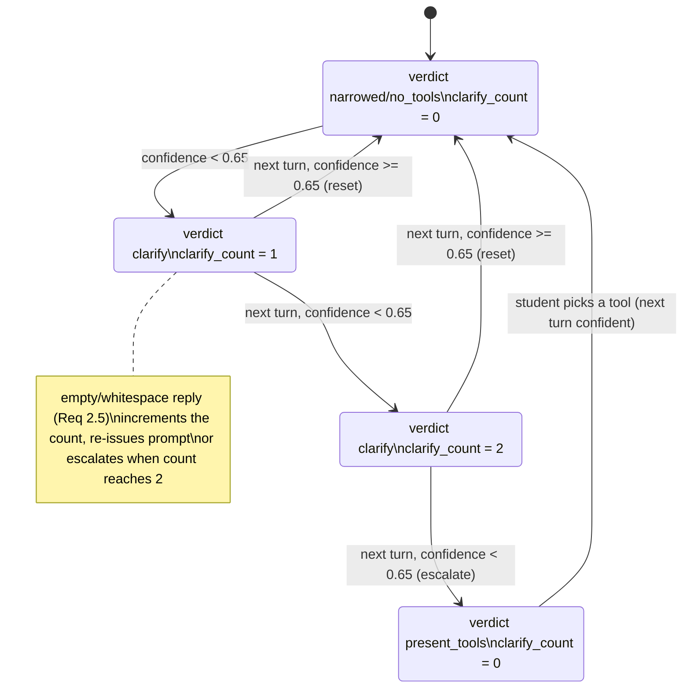

# Design Document — Campus2Career

## Overview

Campus2Career is an intelligent AI tutor for college students preparing for exams, built inside the
AWS User Group Madurai Strands Decider hackathon kit. The agent hands Strands Decider 2B a
meaningful decision — *which of six study tools best handles this student request* — and pairs that
decision with an LLM (Amazon Bedrock Amazon Nova Pro for the submission, the UGMdu hosted cloud
LLM `qwen3.5-4b` for building and testing) for the conversational and generative part.

The reusable decision pattern uses the **tool-selection seam** (`#tool-selection`): before the
Strands Agent runs, the decider reads the student's request (and any uploaded screenshot) and
selects the most suitable of six study tools, or "none" when no tool is needed. The Agent is then
wired with only that tool (fewer tools in context means fewer wrong calls, fewer tokens, and a
faster LLM turn). When the decider is unsure (confidence below 0.65), the agent asks the student
to clarify rather than running a tool; after two consecutive failed clarifications it presents
all six tools and asks the student to pick one explicitly.

This design replaces the kit's shipped example (an online-store support agent that uses the
`#guardrails` pattern) with the Campus2Career tutor that uses the `#tool-selection` pattern. Only
the `agent/` package changes; `decider_kit/` and the rest of the kit are reused unchanged.

### Scope and non-goals

In scope: the `Tool_Selector` decision pattern, the six study tools, the `HackathonAgent` chat
interface, session/clarification state, image support, labelled evaluation cases, and the
AgentCore deployment configuration.

Non-goals: real (non-synthetic) data sources, multi-turn tool chaining, user accounts, and any
change to `decider_kit/` or the kit commands. Tool outputs are **deterministic synthetic data**
(Requirement 8); only the conversational reply is LLM-generated.

## Architecture

Campus2Career sits in `agent/` and reuses `decider_kit/` as a library. The decider makes the
tool-selection decision **before** the Strands Agent runs; the Agent then runs with the narrowed
tool set (or no tools, or all tools, depending on the verdict).



### Per-turn data flow

Every `chat(message, session_id, images)` call follows the same sequence. The decider always
runs first and decides the verdict; the Agent runs second with the tool set the verdict implies.



### Key design decisions and rationale

1. **`#tool-selection` over `#guardrails`.** The kit example uses `#guardrails` (an
   `InterventionHandler` that checks each tool call). Campus2Career instead picks the tool
   *before* the Agent runs and hands the Agent only that tool. This is the pattern's reason for
   existing: fewer tools in the LLM context means fewer wrong calls and a smaller prompt
   (`decider_kit/patterns/tool_selection.py`, `decider.md`).

2. **One `Tool_Selector` plus per-session clarification state.** A single `Tool_Selector` is
   owned by the `HackathonAgent`. The clarification count is tracked per `session_id` inside the
   selector, because "two consecutive clarifications" is a per-conversation notion
   (Requirements 2.3–2.5).

3. **History is preserved by replaying session messages; the Agent is built per turn with the
   narrowed tool set.** Requirement 5.6 asks for conversation history to be preserved across
   turns. Strands preserves history natively only inside one `Agent` instance, but tool-selection
   needs a *different* tool set each turn, and an `Agent`'s tools are fixed at construction. We
   resolve this by storing each session's accumulated `messages` list and building the Agent
   for the turn with the selected tools plus the replayed history. This honours the *goal* of 5.6
   (history preserved) while letting us literally narrow the tool set per turn — the point of the
   pattern. The cost is rebuilding the Agent each turn (O(turns) history replay), acceptable for
   the demo's short conversations.

4. **Clarification is a deterministic short-circuit.** On a `clarify` verdict the agent returns a
   templated clarification prompt and runs **neither** the LLM **nor** a tool. This makes
   Requirement 2.1 ("ask the student to clarify rather than running a tool") literally true and
   keeps the demo and tests deterministic. All six tools stay registered in the selector so the
   follow-up can be routed to a tool (Requirement 2.2). The alternative — running the LLM with
   all six tools plus a deny-all `InterventionHandler` to guarantee no tool runs — is noted as a
   tradeoff; determinism and simplicity favour the short-circuit.

5. **`present_tools` runs the LLM.** After two consecutive failed clarifications, the Agent runs
   with all six tools and a system-prompt directive to present the six capabilities and ask the
   student to pick one (Requirement 2.4). This is the one low-confidence path that uses the LLM.

6. **Threshold is 0.65, not the kit default 0.6.** Requirements 1.3/1.4 and 2.1 pin the confidence
   threshold at 0.65; the `Tool_Selector` uses `threshold=0.65` (the kit's `ToolSelector` defaults
   to 0.6).

7. **60 evaluation cases (48 tune / 12 test).** Requirement 7.3 demands at least 12 test cases
   and at least 24 total; Requirement 8.2 demands an 80% tune / 20% test split. The smallest set
   satisfying both is 60 cases: 48 tune (80%) and 12 test (20%). This is a deliberate
   reconciliation of the two requirements.

8. **Tools use synthetic data; the conversational reply uses the LLM.** Requirement 8.1 requires
   tools to be deterministic. Each tool draws from a fixed synthetic dataset in `agent/data/` (via
   `decider_kit.data.load`) with deterministic generation, so two runs with the same input are
   identical. The Agent's conversational reply is LLM-generated (non-deterministic) but that is
   the conversation, not the tool output.

## Components and Interfaces

### `agent/decision.py` — the reusable decision pattern

The labelled decision pattern. It defines the tag, the typed questions, and the `Tool_Selector`
class. It is self-contained (imports `TOOLS` from `tools.py`; no circular import, since
`tools.py` does not import `decision.py`).

**Module-level constants:**

- `PATTERN_TAG = "#tool-selection"` — exactly one of the five kit tags.
- `QUESTIONS` — a `dict[str, dict]` with a single key `"tool"`, a `choice` question whose options
  are the six tool names (each described by that tool's docstring) plus a `"none"` option. Built
  once at import from `TOOLS`, so it is stable for the benchmark and so adding a tool needs no
  change here (Requirement 6.4). The `"none"` option is described as indicating no tool is
  needed (Requirement 1.2).
- No `IS_KIT_EXAMPLE` flag (Requirement 6.3; the submission check fails while it is present).
- Module docstring headed `REUSABLE DECISION PATTERN:` with four sections: *what it does*, *typed
  questions and options*, *the wiring*, *how to reuse it* (Requirement 6.2).

**`Tool_Selector` class:**

```python
class Tool_Selector:
    def __init__(self, decider: Decider, tools: list, threshold: float = 0.65,
                 max_clarifications: int = 2): ...
    def select(self, request: str, history: str = "", images: list | None = None,
               session_id: str = "default") -> Selection: ...
    def tools_for(self, request: str, history: str = "", images: list | None = None,
                  session_id: str = "default") -> list: ...
    def reset(self, session_id: str = "default") -> None: ...
    # log: list[dict]  — one decision record per decider call
    # clarify_count: dict[str, int] — consecutive clarifications per session
```

- `__init__` validates that every tool has a non-empty one-line docstring; a tool without one is
  rejected with a message that a docstring is required (Requirement 6.5). It builds the option
  map (name → docstring) reused by `QUESTIONS` and `select`.
- `select` encodes `request` together with `history` (conversation from earlier turns in the
  same session) as the **state**, asks all questions in a **single** `decider.ask` call, and
  passes `images` through to the decider (Requirements 1.5, 4.1). It maps the decider result plus
  the session's clarification count to a verdict and a tool set.
- `tools_for` returns the tool set for the turn (`select` wrapped). On any `DeciderError` it
  returns all six tools (Requirement 1.6) with verdict `"fallback"`.

**`Selection` dataclass:**

```python
@dataclass
class Selection:
    tool: str            # selected option label, or "none"
    confidence: float    # Tool_Confidence in [0, 1]
    probabilities: dict[str, float]   # every option → probability in [0, 1]
    verdict: str         # narrowed | no_tools | clarify | present_tools | fallback
    tools: list          # the tools to wire into the Agent this turn
    decision: Decision    # the raw Decider answer
```

**Verdict logic** (`select`), given a decider `Decision` `d` for question `"tool"`:

| Condition | verdict | `tools` | clarify_count |
|---|---|---|---|
| decider raised `DeciderError` | `fallback` | all 6 | reset to 0 |
| `d.confidence >= 0.65` and `d.label != "none"` | `narrowed` | `[selected]` | reset to 0 |
| `d.confidence >= 0.65` and `d.label == "none"` | `no_tools` | `[]` | reset to 0 |
| `d.confidence < 0.65` and `clarify_count < 2` | `clarify` | all 6 (retained) | +1 |
| `d.confidence < 0.65` and `clarify_count >= 2` | `present_tools` | all 6 | reset to 0 |

Each `select` appends one decision record to `self.log` (see Data Models).

### `agent/tools.py` — the six study tools

Six Strands `@tool` functions, each with a one-line docstring that the `Tool_Selector` uses as
its option description (Requirement 3.8). `TOOLS = [concept_explainer, exam_planner,
practice_generator, code_debugger, resource_recommender, aptitude_coach]` — exactly six.

| Tool (function name) | Docstring (one line) | Inputs | Output guarantee |
|---|---|---|---|
| `concept_explainer` | Explains a technical topic in plain language, defining any terms used. | `topic: str` (1–200 chars) | a plain-language explanation (non-empty) |
| `exam_planner` | Creates a prioritized study plan ordered by exam timing and study time. | `exam_subject: str`, `exam_date: str`, `available_study_time: str` | a plan with ≥1 task, ordered |
| `practice_generator` | Generates practice questions with answers for a topic. | `topic: str`, `question_count: int` (1–50), `question_format: str` (quiz\|mcq\|mock test) | exactly `count` questions, each with an answer |
| `code_debugger` | Analyzes a code error and suggests fixes as a numbered sequence of steps. | `code_or_error: str` (non-empty) | a numbered sequence of steps (1, 2, 3, …) |
| `resource_recommender` | Suggests tutorials, documentation, and courses for a topic. | `topic: str` | a list of ≥1 resource |
| `aptitude_coach` | Produces aptitude questions and English communication exercises. | `category: str` (quantitative\|logic\|verbal\|communication) | ≥1 question, or ≥1 communication exercise |

- **Determinism (Requirement 8.1):** each tool loads a fixed synthetic dataset from
  `agent/data/<name>.json` via `decider_kit.data.load` and generates output deterministically from
  the input (e.g., `practice_generator` slices/templating is keyed by `topic` and `count`).
  Inputs are validated and out-of-range inputs are clamped or rejected with a clear message.
- **Image-aware tool (Requirement 4.3):** `code_debugger` is declared `@tool(context=True)` and
  reads any attached screenshot via `decider_kit.llm.attached_images(tool_context)`, referencing
  the visible error content in its analysis.

### `agent/agent.py` — the `HackathonAgent`

Keeps the kit's chat contract so the demo UI, benchmark, video, and deployment keep working.

**Constants:**

- `NAME = "Campus2Career: an AI exam-prep tutor"` (Requirement 5.1).
- `SYSTEM_PROMPT` — a tutor persona that helps with exam preparation and, for safety, never
  claims to run on Amazon Bedrock when it is not (Requirement 9.4).
- `PRESENT_TOOLS_PROMPT` — a turn-specific addendum used only on `present_tools` verdicts,
  instructing the Agent to present the six tool capabilities and ask the student to pick one.
- `CLARIFY_PROMPT` — the templated clarification prompt returned on `clarify` verdicts.

**`HackathonAgent` class:**

```python
class HackathonAgent:
    def __init__(self, decider: Decider | None = None, model_id: str | None = None,
                 eager: bool | None = None): ...
    def chat(self, message: str, session_id: str = "default",
             images: list | None = None) -> dict[str, Any]: ...
    # sessions: dict[session_id, dict]  — {messages: list, agent: Agent | None}
    # selector: Tool_Selector
```

- `__init__` creates the `Decider`, the `Tool_Selector(decider, TOOLS, threshold=0.65)`, the
  model id (via `default_model_id()`), the `eager` flag, and the `sessions` map. `eager` is
  honoured exactly as in the kit (it only swaps the system prompt for the demo).
- `_session(session_id)` lazily creates a session record `{"messages": [], "agent": None}`.
- `chat(message, session_id, images)`:
  1. Resolve the session and its accumulated `messages`.
  2. **Empty/whitespace message handling (Requirement 2.5):** if `message.strip() == ""`:
     - if `selector.clarify_count[session_id] > 0` (a clarification is pending): treat it as a
       failed clarification response — increment the count; if it reaches `max`, escalate to
       `present_tools` (run the Agent with all six tools); otherwise re-issue `CLARIFY_PROMPT`.
     - else (no clarification pending): return a gentle prompt asking the student to describe
       what they need (no decider call, no tool).
  3. Otherwise call `selector.tools_for(message, history, images, session_id)`, where `history`
     is rendered from the session's `messages`. Wrap the call in `try/except DeciderError` so a
     decider failure yields all six tools with verdict `fallback` (Requirement 1.6); an image
     decode/format failure (`DeciderError` from `encode_images`) is caught here and returns a
     reply indicating the image could not be read without raising (Requirement 4.5).
  4. Branch on the verdict:
     - `clarify`: append the user message to history, return `{"reply": CLARIFY_PROMPT, ...}`
       (no LLM, no tool). All six tools remain in the selector for the follow-up.
     - `narrowed` / `no_tools` / `present_tools` / `fallback`: build (or rebuild) the session
       `Agent` with `tools` and the replayed `messages` as history, call it with the message plus
       `image_blocks(images)` (Requirement 4.2), and `strip_thinking` the reply. On
       `present_tools` the system prompt gets `PRESENT_TOOLS_PROMPT` appended.
  5. Append the user message and the assistant reply to `session["messages"]`.
  6. Return `{"reply", "decisions": selector.log[slice], "model_id", "latency_ms"}` (Requirement
     5.2). `latency_ms` is a non-negative integer (ms) measured with `time.perf_counter`.

### `agent/eval_cases.jsonl` — labelled evaluation cases

One JSON object per line: `{"state": str, "expected": {"tool": "<label>"}, "split": "tune"|"test"}`
(Requirements 7.1, 7.2). The `state` uses the **same text layout** `Tool_Selector.select` sends to
the decider at run time (the `state` builder is shared, so the layout is identical by
construction). 60 cases: 48 tune (80%) and 12 test (20%) (Requirement 8.2), covering all six tools
plus `none`, ambiguous (low-confidence) requests, and screenshot-aided cases. Each `expected.tool`
label is the tool's function name (or `"none"`), matching the `QUESTIONS` choice options (the
benchmark lowercases labels via `_norm`).

### `agent/demo_script.yaml`, `agent/features.yaml`, `agent/AGENT.md`

- `demo_script.yaml` — the turns the video plays: a clear tool-selection turn, a low-confidence
  clarification turn, a `present_tools` escalation turn, and a screenshot/code-error turn, each
  with neutral narration. `eager: false` (the tutor's normal behaviour).
- `features.yaml` — both AgentCore Memory and Gateway **off**: Campus2Career uses local
  `@tool` functions and in-session history, so neither AgentCore feature is needed for the
  submission.
- `AGENT.md` — the use-case description driving the code, benchmark, article, and video.

### Reused `decider_kit/` interfaces (unchanged)

- `Decider.ask(state, questions, images=None)` → `dict[str, Decision]`; `Decision.label`,
  `.confidence`, `.probabilities`; `.last_latency_ms`.
- `decider_kit.llm.agent_model(model_id=None)`, `image_blocks(images)`,
  `attached_images(tool_context)`, `strip_thinking(text)`, `default_model_id()`.
- `decider_kit.patterns.tool_selection._describe` / `questions_for` — the `Tool_Selector`
  mirrors this docstring-as-option logic so its `QUESTIONS` matches the kit's convention.
- `decider_kit.bench` — loads `agent.decision:QUESTIONS`, runs decider vs. LLM baseline on the
  test split, reports accuracy and median latency.

## Data Models

### Decision record (one entry in `decisions`)

Each `decider.ask` call appends one record to `Tool_Selector.log`, returned in the chat dict's
`decisions` list (Requirement 5.3):

```json
{
  "pattern": "#tool-selection",
  "tool": "concept_explainer",
  "confidence": 0.82,
  "probabilities": {"concept_explainer": 0.82, "exam_planner": 0.05, "practice_generator": 0.04,
                    "code_debugger": 0.03, "resource_recommender": 0.03, "aptitude_coach": 0.02, "none": 0.01},
  "verdict": "narrowed",
  "narrowed": true,
  "clarify_count": 0,
  "decider_ms": 812
}
```

- `tool` — the selected option label (one of the six tool names or `"none"`); `"fallback"` is not
  a label — on decider failure `tool` is `null` and `verdict` is `"fallback"`.
- `probabilities` — every option → probability, each in `[0, 1]`.
- `verdict` — one of `narrowed | no_tools | clarify | present_tools | fallback`.
- `narrowed` — `true` only when the Agent is narrowed to a single tool.
- `decider_ms` — non-negative integer milliseconds (`decider.last_latency_ms`).

### Session state

```python
sessions: dict[str, dict] = {
  "<session_id>": {
    "messages": [ {"role": "user", "content": [{"text": "..."}]},
                  {"role": "assistant", "content": [{"text": "..."}]}, ... ],
    "agent": Agent | None   # built/rebuilt per turn with the selected tools
  }
}
# plus, inside Tool_Selector:
clarify_count: dict[str, int]   # consecutive clarifications issued per session_id
```

### Clarification state machine



### Tool input/output schemas

```python
concept_explainer(topic: str) -> {"explanation": str}            # topic 1..200 chars
exam_planner(exam_subject: str, exam_date: str, available_study_time: str)
    -> {"plan": [{"task": str, "priority": int, "by_date": str}]}  # >= 1 task
practice_generator(topic: str, question_count: int, question_format: str)
    -> {"questions": [{"question": str, "answer": str}]}          # count in 1..50
code_debugger(code_or_error: str) -> {"steps": [{"n": int, "step": str}]}  # 1-indexed
resource_recommender(topic: str) -> {"resources": [{"title": str, "type": str, "url": str}]}  # >= 1
aptitude_coach(category: str) -> {"questions": [{"question": str, "answer": str}]}  # >= 1
```

### `eval_cases.jsonl` schema

```json
{"state": "Conversation so far:\nuser: Explain recursion simply.\n\nUser request: Explain recursion simply.",
 "expected": {"tool": "concept_explainer"}, "split": "tune"}
```

### Synthetic data sets (`agent/data/`)

Fixed JSON files loaded by `decider_kit.data.load`: `topics.json`, `exam_plans.json`,
`practice_questions.json`, `code_errors.json`, `resources.json`, `aptitude.json`. Generated once
with `./kit data` and committed, so tools are deterministic (Requirement 8.1).

## Correctness Properties

*A property is a characteristic or behavior that should hold true across all valid executions of a
system — essentially, a formal statement about what the system should do. Properties serve as the
bridge between human-readable specifications and machine-verifiable correctness guarantees.*

The decider itself is an external model and is **not** property-tested directly. Instead, the
selection logic, verdict mapping, clarification state machine, tool input validation, and image
plumbing are **our code** and are property-tested using a `FakeDecider` (from `tests/fakes.py`)
that lets us drive the decider's label, confidence, and failure mode. This is the "PROPERTY with
mocks" pattern: the mock provides controlled decider outputs, and the properties verify our logic.

### Property 1: Single decider call carries request and history

*For any* non-empty student request and any conversation history, the `Tool_Selector` SHALL make
exactly one `decider.ask` call with a single `choice` question whose state contains both the
request and the history, and this call SHALL occur before any Strands Agent is built or run.

**Validates: Requirements 1.1, 1.5**

### Property 2: Choice question is built from tool docstrings

*For any* set of tools each having a non-empty one-line docstring, the `tool` choice question
SHALL have exactly the six tool names plus a `none` option, each tool option's description SHALL
equal that tool's docstring first line, the `none` option SHALL indicate that no tool is needed,
and adding a tool with a docstring SHALL add its option automatically without editing `QUESTIONS`
or retraining Strands_Decider_2B.

**Validates: Requirements 1.2, 3.8, 6.4**

### Property 3: Confident selection narrows correctly

*For any* decider result with `Tool_Confidence` greater than or equal to 0.65, the
`Tool_Selector` SHALL narrow the Agent's tools to exactly the selected tool (verdict `narrowed`)
when a tool is selected, or to no tools (verdict `no_tools`) when `none` is selected, and SHALL
reset the session's clarification count to zero.

**Validates: Requirements 1.3, 1.4**

### Property 4: Decider failure falls back to all six tools

*For any* `DeciderError` raised by the decider, `Tool_Selector.tools_for` SHALL return all six
tools with verdict `fallback`, SHALL NOT propagate the exception, and SHALL reset the
clarification count.

**Validates: Requirements 1.6**

### Property 5: Low-confidence clarification retains all tools and runs no tool

*For any* decider result with `Tool_Confidence` below 0.65 when the clarification count is less
than 2, the `Tool_Selector` SHALL set verdict `clarify`, SHALL keep all six tools available for
the follow-up, SHALL run neither the LLM nor a tool for that turn, and the student's next
non-empty message SHALL be re-evaluated against the six tools producing an updated
`Tool_Confidence`.

**Validates: Requirements 2.1, 2.2, 2.3**

### Property 6: Clarification escalation state machine

*For any* sequence of turns, when the clarification count reaches 2 consecutive low-confidence
clarifications, the next low-confidence turn SHALL yield verdict `present_tools` with all six
tools and reset the count; and *for any* empty or whitespace-only student reply while a
clarification is pending, the system SHALL re-issue the clarification prompt and count that
reply toward the maximum of 2 clarification attempts before escalating.

**Validates: Requirements 2.4, 2.5**

### Property 7: Concept_Explainer validates topic length and returns a non-empty explanation

*For any* topic string of length 1 to 200, `concept_explainer` SHALL return a non-empty
explanation; and *for any* topic of length 0 or greater than 200, `concept_explainer` SHALL reject
the input rather than produce a partial result.

**Validates: Requirements 3.1**

### Property 8: Practice_Generator returns exactly the requested count, each with an answer

*For any* requested question count in 1 to 50, `practice_generator` SHALL return exactly that
many questions and every question SHALL have an answer; and *for any* count below 1 or above 50,
the count SHALL be clamped to the nearest bound (1 or 50) before generation.

**Validates: Requirements 3.3**

### Property 9: Code_Debugger returns a 1-indexed numbered sequence of steps

*For any* non-empty code or error text, `code_debugger` SHALL return a numbered sequence of steps
whose numbers are 1, 2, 3, ... in order with no gaps; and *for any* empty input, `code_debugger`
SHALL reject the input.

**Validates: Requirements 3.4**

### Property 10: Study tools return at least one correctly-typed item for valid input

*For any* valid input, `exam_planner` SHALL return a plan with at least 1 task ordered by exam
timing and study time, `resource_recommender` SHALL return at least 1 resource, `aptitude_coach`
SHALL return at least 1 question in the requested category (quantitative, logic, or verbal) when
given an aptitude category, and at least 1 English communication exercise when given the
communication category.

**Validates: Requirements 3.2, 3.5, 3.6, 3.7**

### Property 11: Uploaded images reach the decider and the agent as image blocks

*For any* message accompanied by images in the form of file paths, base64 strings, or bytes, the
`Tool_Selector` SHALL pass those images to `decider.ask`, and the `HackathonAgent` SHALL pass
them to the Strands Agent as Strands image content blocks, regardless of which of the three input
forms is used.

**Validates: Requirements 4.1, 4.2, 4.4**

### Property 12: Code_Debugger reads attached screenshots

*For any* call to `code_debugger` made in a turn where screenshots were attached, the tool SHALL
read the attached images via its tool context and SHALL produce its analysis referencing the
visible error content.

**Validates: Requirements 4.3**

### Property 13: Unsupported images return a graceful message without raising

*For any* uploaded image that cannot be decoded or is in an unsupported format (including
garbage bytes, unsupported types, and more than four images), the `chat` method SHALL return a
response indicating the image could not be read and SHALL NOT raise an unhandled exception.

**Validates: Requirements 4.5**

### Property 14: Chat dict and decision records have the required shape and ranges

*For any* `chat` call, the returned dict SHALL contain `reply` as a string, `decisions` as a list
with one entry per decider call, `model_id` as a string, and `latency_ms` as a non-negative
integer; and *for any* decision record, the probabilities SHALL each lie in [0, 1], the verdict
SHALL be one of `narrowed`, `no_tools`, `clarify`, `present_tools`, or `fallback`, and
`decider_ms` SHALL be a non-negative integer.

**Validates: Requirements 5.2, 5.3**

### Property 15: Conversation history is preserved per session

*For any* two turns in the same `session_id`, the second turn's conversation history SHALL contain
the first turn's user message; and *for any* turn in a different `session_id`, its history SHALL
NOT contain messages from another session.

**Validates: Requirements 5.6**

### Property 16: Evaluation-case state layout matches the runtime state builder

*For any* student request (with optional history), the state text the `Tool_Selector` builds at
run time SHALL use the same layout as every case's `state` in `agent/eval_cases.jsonl`, and every
evaluation-case state SHALL parse under that shared layout.

**Validates: Requirements 7.2**

### Property 17: Tool outputs are deterministic

*For any* tool and any valid input, calling the tool twice with the same input SHALL produce
byte-identical output.

**Validates: Requirements 8.1**

### Property 18: Evaluation split is 80/20 tune/test with no overlap

*For the* full set of evaluation cases, the tune split SHALL contain approximately 80% of the
cases and the test split the remaining 20%, and no case SHALL appear in both splits (disjoint by
state).

**Validates: Requirements 8.2**

### Property 19: A tool without a docstring is rejected

*For any* tool added without a non-empty docstring, the `Tool_Selector` constructor SHALL reject
it and SHALL indicate that a docstring is required.

**Validates: Requirements 6.5**

## Error Handling

- **Decider unavailable or failing (Requirement 1.6).** `DeciderError` from `decider.ask` is
  caught in `Tool_Selector.tools_for`; the selector records verdict `fallback`, keeps all six
  tools, resets the clarification count, and the Agent runs normally so the student still gets a
  response. The exception never reaches the caller.
- **Unsupported or undecodable images (Requirement 4.5).** `encode_images` raises `DeciderError`
  for unsupported types and for more than four images. `HackathonAgent.chat` wraps the selector
  call in `try/except DeciderError`; on an image error it returns a reply stating the image could
  not be read and skips the turn rather than raising. Valid images (PNG, JPEG, WebP, GIF, ≤4) are
  passed through to both the decider and the Agent.
- **Empty or whitespace-only messages (Requirement 2.5).** A whitespace-only message during a
  pending clarification re-issues the clarification and counts toward the maximum of two; with no
  pending clarification it returns a gentle prompt asking the student to describe their need. No
  decider call is made for an empty message.
- **Out-of-range tool inputs.** Each tool validates its inputs: `concept_explainer` rejects
  topics outside 1–200 characters; `practice_generator` clamps the count to 1–50;
  `code_debugger` rejects empty code/error text; categories outside the allowed set are rejected
  with a clear message. Tools never raise; they return a descriptive error object.
- **Image count limit.** The decider accepts at most four images per request; extra images are
  dropped with a note (the first four are used) rather than failing the turn.
- **Session isolation.** A failure in one session (e.g., an image error) does not affect another
  session's state or clarification count.

## Testing Strategy

### Dual testing approach

- **Property-based tests** verify the universal properties above across many generated inputs.
- **Unit tests** cover specific examples, the contract/interface checks, and the edge cases that
  generators exercise.
- **Integration tests** cover the reused benchmark feeding our cases and the AgentCore deployment
  smoke checks.

Property-based testing **is** appropriate for this feature: the selection logic, verdict
mapping, clarification state machine, tool input validation, and image plumbing are pure
functions with clear input/output behavior and universal properties that hold across a large
input space. They are not IaC, UI rendering, simple CRUD, or side-effect-only operations.

### Property-based tests

- **Library:** `hypothesis` (the standard property-based testing library for Python), running
  under the kit's `pytest` (`./kit test`). Each property in the Correctness Properties section is
  implemented as a **single** `@given`-decorated test.
- **Iterations:** each property test is configured with `max_examples=100` (minimum 100
  iterations) via a `hypothesis.settings` profile.
- **Decider mocking:** decider-dependent properties use `FakeDecider` (from `tests/fakes.py`)
  with a `rule` that drives the selected label, confidence, and failure mode, so the decider is
  never called over the network during tests.
- **Tagging:** every property test carries a comment tag of the form
  `# Feature: campus2career, Property {n}: {property_text}` referencing its design property.
- **Generators:** custom `hypothesis` strategies generate valid topics (1–200 chars, including
  unicode and edge lengths), counts (1–50 plus out-of-range), categories, tool sets with/without
  docstrings, image forms (path/base64/bytes/garbage), session sequences for the state machine,
  and request/history pairs. Edge cases (empty strings, length boundaries, >4 images, missing
  docstrings) are covered by the generators.

### Unit tests (examples and contracts)

These acceptance criteria are verified with example-based unit tests rather than properties:

- **Interface contract (5.1, 5.4, 5.5):** `NAME` and `HackathonAgent` exist; `chat` returns a
  dict; the constructor accepts `eager` as `bool` or `None`; `chat` has an `images=None` parameter.
- **Pattern labelling (6.1, 6.2, 6.3):** `PATTERN_TAG == "#tool-selection"`; `QUESTIONS` is a
  non-empty dict of typed questions; the module docstring starts with `REUSABLE DECISION
  PATTERN:` and contains the four required sections; the source contains no `IS_KIT_EXAMPLE`.
  These are enforced by `tests/test_agent_contract.py` and `scripts/check_submission.py`.
- **Provider non-misrepresentation (9.4):** the system prompt instructs the agent not to claim
  Amazon Bedrock unless it actually runs there; the returned `model_id` reflects the real
  provider (`describe()`), never a hardcoded `bedrock` string when running on UGMdu.
- **Evaluation case structure (7.1, 7.3):** every `eval_cases.jsonl` line has a non-empty `state`,
  an `expected` dict whose keys are a subset of `QUESTIONS`, and a `split` in `{tune, test}`;
  totals meet 7.3 (≥24 total, ≥12 test).

### Integration tests

- **Benchmark on the test split (7.4, 8.3):** run `decider_kit.bench` with `--split test` against
  `agent/eval_cases.jsonl` and `agent.decision:QUESTIONS` using `FakeDecider`; assert the report
  contains accuracy and median latency for the decider and that every row corresponds to a
  test-split case. (1–2 examples; the benchmark itself is reused kit code.)

### Smoke tests

- **Deployment (9.1, 9.2):** assert the AgentCore project (`deploy/agentcore`) targets the
  runtime with the agent entrypoint and that the submission's model id is Amazon Nova Pro.
- **Local LLM (9.3):** with `LLM_PROVIDER=ugmdu`, assert `default_model_id()` resolves to
  `qwen3.5-4b`.
- **Strands-only LLM access (9.5, 9.6):** assert `agent.py` and `tools.py` build models via
  `agent_model()`/a Strands `Agent` and contain no direct `boto3` `converse`/`invoke_model` or
  provider SDK calls (enforced by the kit's provider check).
